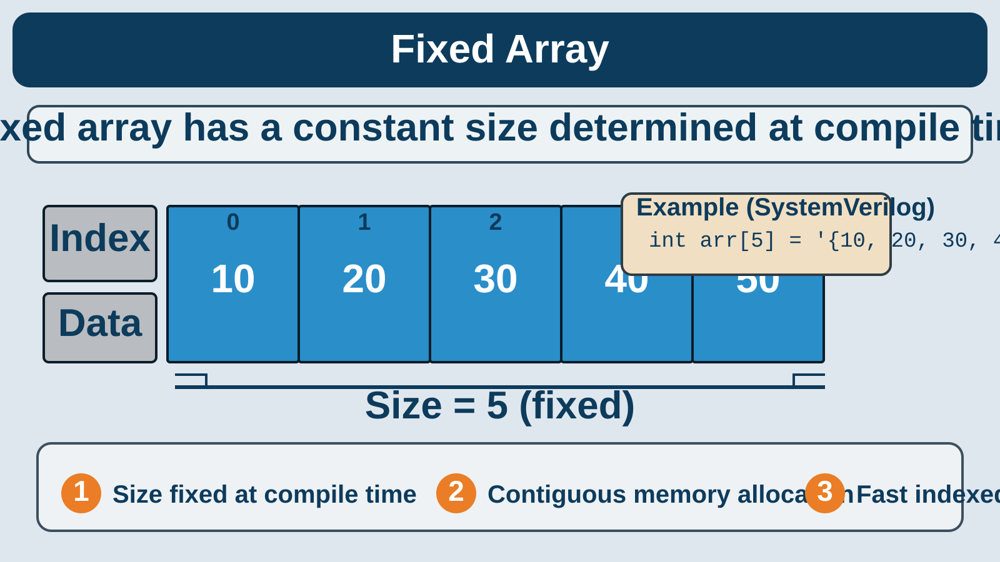

# Associative Array in SystemVerilog

This example explains the difference between a fixed array and an associative array in SystemVerilog, and shows how associative arrays are useful for sparse or dynamic transaction IDs such as AXI transaction numbers.

## Overview

This example demonstrates how to use a SystemVerilog associative array to track AXI transaction IDs and their associated metadata. Associative arrays are ideal for verification environments where the number of entries is dynamic and keys are not sequential integers.

In AXI-based testbenches, you often need to:

- store outstanding transactions by ID,
- look up a transaction when a response arrives,
- check whether a key already exists,
- iterate through active entries,
- remove completed transactions.

This example shows those operations in a compact, readable form.

Source file: `axi_transaction_order.sv`

## Fixed Array vs Associative Array

A fixed array has a constant size defined at compile time.



### Fixed array

```systemverilog
int arr[5] = '{10, 20, 30, 40, 50};
```

- size is fixed at compile time
- memory is contiguous
- indexing is fast and predictable
- best when the index range is known and dense

### Associative array

```systemverilog
typedef logic [15:0] transaction_t[int];
transaction_t transaction_types;

transaction_types[101] = 16'hAA;
transaction_types[105] = 16'hBB;
transaction_types[109] = 16'hCC;
```

An associative array is different:

- keys are not required to be sequential
- memory grows only for used entries
- ideal for sparse IDs such as AXI transaction numbers
- useful for lookup, insertion, deletion, and iteration

## Why Associative Arrays?

A fixed-size array requires a known index range, but AXI transactions often appear as sparse IDs such as 101, 105, 106, and 109. An associative array lets you index by a key value instead of a dense numeric range.

This makes associative arrays useful for:

- UVM scoreboards
- reference models
- memory tracking
- cache verification
- transaction logging

## Module Summary

| Item | Value |
|---|---|
| Module | `axi_transaction_order` |
| Data structure | Associative array |
| Key type | `int` |
| Value type | `logic [15:0]` |
| Example keys | `101`, `105`, `106`, `109` |
| Use case | AXI transaction tracking |

## Why associative arrays matter in AXI verification

In AXI-based testbenches, transaction IDs are often sparse and dynamic. For example:

- 101
- 105
- 106
- 109

A fixed array would waste memory because the index range is not continuous, while an associative array stores only the actual entries.

## Associative Array Declaration

```systemverilog
typedef logic [15:0] transaction_t[int];
transaction_t transaction_types;
```

This declares an associative array where:

- the key type is `int`
- the value type is 16-bit logic
- each transaction ID maps to a stored value

Example:

```systemverilog
transaction_types[101] = 16'hAA;
transaction_types[105] = 16'hBB;
transaction_types[109] = 16'hCC;
```

## Core associative array operations

```systemverilog
transaction_types.num();
transaction_types.exists(id);
transaction_types.first(id);
transaction_types.last(id);
transaction_types.next(id);
transaction_types.prev(id);
transaction_types.delete(id);
```

## Core Associative Array Methods

| Method | Description |
|---|---|
| `num()` | Returns the number of entries stored. |
| `exists(index)` | Checks whether a specific key exists. |
| `first(index)` | Gets the first key in traversal order. |
| `last(index)` | Gets the last key in traversal order. |
| `next(index)` | Gets the next valid key after the current one. |
| `prev(index)` | Gets the previous valid key before the current one. |
| `delete(index)` | Removes an entry associated with a key. |
| `foreach` | Iterates over all existing entries. |

Important note:

- `first()`, `last()`, `next()`, and `prev()` use a variable passed by reference.
- You must check the value of the index after the call to determine whether a valid key was found.

## Example: AXI transaction tracking

```systemverilog
module axi_transaction_order;

  typedef logic [15:0] transaction_t[int];
  transaction_t transaction_types;
  int axi_id;

  initial begin
    $display("INITIAL_TRANSACTION = %0d", transaction_types.num());

    transaction_types[101] = 'hAA; // READ
    transaction_types[105] = 'hBB; // WRITE
    transaction_types[109] = 'hCC; // BURST_READ
    transaction_types[106] = 'hDD; // BURST_WRITE

    $display("AFTER_TRANSACTION = %0d", transaction_types.num());

    foreach (transaction_types[axi_id])
      $display("FOR_TRANSACTION[%0d] = %0h", axi_id, transaction_types[axi_id]);

    if (transaction_types.first(axi_id))
      $display("FIRST_ID = %0d TRANS_TY = %0h", axi_id, transaction_types[axi_id]);

    if (transaction_types.last(axi_id))
      $display("LAST_ID = %0d TRANS_TY = %0h", axi_id, transaction_types[axi_id]);

    if (transaction_types.next(axi_id))
      $display("NEXT_ID = %0d TRANS_TY = %0h", axi_id, transaction_types[axi_id]);
    else
      $display("NO_NEXT_ID");

    if (transaction_types.prev(axi_id))
      $display("PREV_ID = %0d TRANS_TY = %0h", axi_id, transaction_types[axi_id]);
    else
      $display("NO_PREV_ID");

    if (transaction_types.exists(107))
      $display("READ Transaction Found");
    else
      $display("READ Transaction Not Found");

    if (transaction_types.exists(106))
      $display("BURST_WRITE Transaction Found");
    else
      $display("BURST_WRITE Transaction Not Found");

    if (transaction_types.exists(105))
      $display("WRITE Transaction Found");
    else
      $display("WRITE Transaction Not Found");

    transaction_types.delete(105);

    if (transaction_types.exists(105))
      $display("WRITE Transaction Still Exists");
    else
      $display("WRITE Transaction Successfully Deleted");

    $display("\nRemaining Transactions After Deletion");
    foreach (transaction_types[axi_id])
      $display("TRANSACTION[%0d] = %0h", axi_id, transaction_types[axi_id]);
  end
endmodule
```

## Example Workflow

The example does the following:

1. Declares the associative array.
2. Checks the initial number of entries.
3. Inserts transaction IDs and values.
4. Prints all current transactions using `foreach`.
5. Finds the first and last transaction IDs.
6. Navigates to the next and previous IDs.
7. Uses `exists()` to check for specific transaction IDs.
8. Deletes one entry.
9. Prints the remaining transactions.

## Representative output

```text
INITIAL_TRANSACTION = 0
AFTER_TRANSACTION = 4

FOR_TRANSACTION[101] = aa
FOR_TRANSACTION[105] = bb
FOR_TRANSACTION[106] = dd
FOR_TRANSACTION[109] = cc

FIRST_ID = 101 TRANS_TY = aa
LAST_ID = 109 TRANS_TY = cc
NEXT_ID = 109 TRANS_TY = cc
PREV_ID = 105 TRANS_TY = bb

READ Transaction Not Found
BURST_WRITE Transaction Found
WRITE Transaction Found
WRITE Transaction Successfully Deleted

Remaining Transactions After Deletion
TRANSACTION[101] = aa
TRANSACTION[106] = dd
TRANSACTION[109] = cc
```

The exact output may vary slightly depending on compiler behavior and the traversal order used by the simulator.

## Summary

- fixed arrays are good for dense, known index ranges
- associative arrays are good for sparse, dynamic, or transaction-based IDs
- associative arrays are widely used in scoreboards, caches, and AXI verification
- `first()`, `last()`, `next()`, and `prev()` must be checked for validity before use

This is a practical foundation for using associative arrays in SystemVerilog verification environments.

## Running the Example

### Synopsys VCS

Compile:

```bash
vcs -sverilog axi_transaction_order.sv -o simv
```

Run:

```bash
./simv
```

### Questa / ModelSim

Compile:

```tcl
vlog axi_transaction_order.sv
```

Run:

```tcl
vsim -c work.axi_transaction_order -do "run -all; quit"
```

## Application in AXI Verification

In an AXI verification environment, an associative array can be used to maintain a record of outstanding transactions. A typical scoreboard can:

- store expected responses against transaction IDs,
- search the array when a response arrives,
- compare actual and expected data,
- delete completed transactions,
- detect duplicate or unexpected IDs.

This example is educational and intentionally focused on associative-array behavior. A real AXI verification model would also need to consider ordering, outstanding limits, backpressure, and protocol compliance.

## Interview Questions

1. What is an associative array in SystemVerilog?
2. How does it differ from a fixed-size array?
3. Why is it useful in verification scoreboards?
4. What is the difference between `num()` and `size()`?
5. How does `exists()` prevent invalid lookups?
6. What is the purpose of `first()` and `last()`?
7. How do `next()` and `prev()` help traverse keys?
8. What is the difference between `delete()` and assigning a default value?
9. How can an associative array track outstanding AXI transactions?
10. What happens if the same key is inserted twice?

## Project Structure

```text
lakshman_vlsi/
├── README_ASSOCIATIVE_ARRAY.md
├── axi_transaction_order.sv
└── other project files
```

## Learning Outcome

After working through this example, you should be able to:

- declare an associative array in SystemVerilog,
- populate it with transaction IDs,
- iterate through entries,
- check for key existence,
- navigate keys with traversal methods,
- remove entries when transactions complete.

This is a practical foundation for using associative arrays in AXI verification, scoreboard logic, and other dynamic data-tracking tasks.

## Topics

SystemVerilog · Associative Arrays · AXI Verification · Scoreboards · Design Verification

## License

Add a `LICENSE` file if you want to specify the terms under which others may reuse or modify this project.
