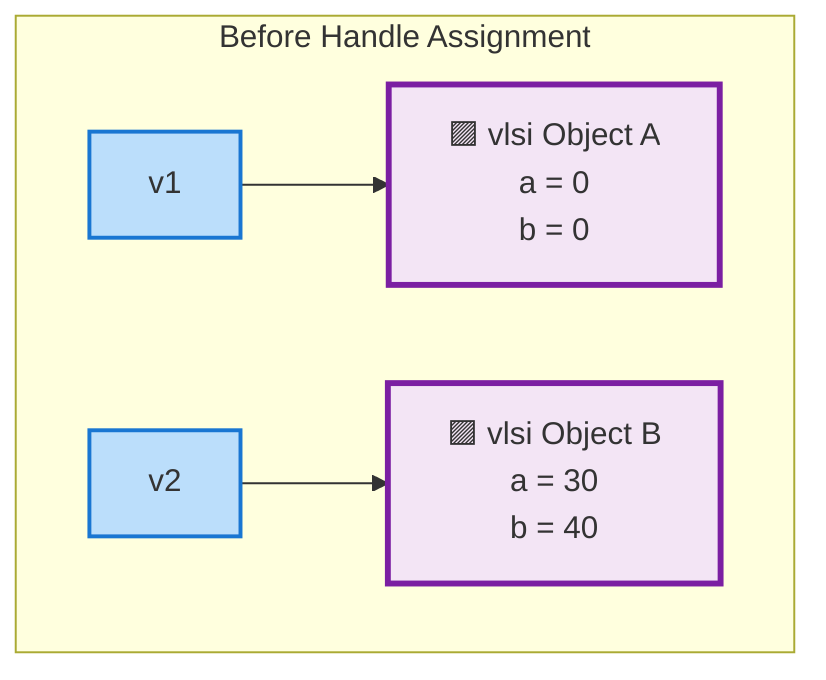
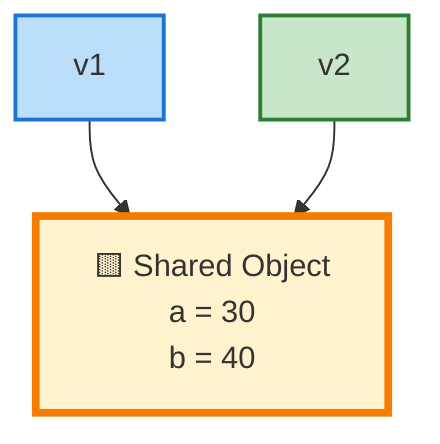

# SystemVerilog Deep Copy Using Nested Class Handles

## 1. Overview

This project demonstrates **deep copying in SystemVerilog** using two classes:

- `packet` — contains a data member `count`.
- `vlsi` — contains data members `a`, `b`, and a handle to a `packet` object.

The `vlsi` class contains a `copy()` method that creates a new `vlsi` object and a new nested `packet` object. It then copies the property values from the source object.

The purpose is to demonstrate how deep copy creates independent objects so that modifying one object does not affect the other.

---
# 1. Concept Diagram

## Before Handle Assignment



---

## Handle Assignment

```systemverilog
v1 = v2;
```

---

## After Handle Assignment



✅ Both handles point to the **same object**

✅ No new object is created

✅ Only the handle/reference is copied

✅ Changes through one handle are visible through the other
## 2. Objective

- Understand class handles in SystemVerilog.
- Understand shallow copy and deep copy.
- Copy scalar properties from one object to another.
- Create a new nested class object during copying.
- Verify that changes to the source object do not affect the copied object.

---

## 3. Class Structure

```text
                 vlsi class
        ┌─────────────────────────┐
        │ int a                   │
        │ int b                   │
        │ packet pck              │
        └────────────┬────────────┘
                     │
                     ▼
               packet class
        ┌─────────────────────────┐
        │ int count               │
        └─────────────────────────┘
```

The `pck` member is a class handle. It refers to a separate `packet` object.

---

## 4. SystemVerilog Code

### File: `deep_copy_nested_class.sv`

```systemverilog
// Deep Copy Using Nested Class Handles

class packet;
  int count;
endclass


class vlsi;

  int a;
  int b;

  packet pck = new();

  // Display object properties
  function void print();
    $display("a=%0d", a);
    $display("b=%0d", b);
    $display("packet count=%0d", pck.count);
  endfunction


  // Deep copy method
  function void copy(output vlsi v);

    // Create a new outer object
    v = new();

    // Copy scalar properties
    v.a = this.a;
    v.b = this.b;

    // Create a new nested packet object
    v.pck = new();

    // Copy nested object property
    v.pck.count = this.pck.count;

  endfunction

endclass


module top;

  vlsi v1, v2;

  initial begin

    // Create objects
    v1 = new();
    v2 = new();

    // Initialize source object
    v2.a = 14;
    v2.b = 42;
    v2.pck.count = 500;

    $display("\n--- Before Deep Copy ---");

    $display("Object v2:");
    v2.print();

    // Deep copy v2 into v1
    v2.copy(v1);

    $display("\n--- After Deep Copy ---");

    $display("Object v1:");
    v1.print();

    $display("Object v2:");
    v2.print();

    // Modify source object
    v2.a = 40;
    v2.b = 50;
    v2.pck.count = 600;

    $display("\n--- After Modifying v2 ---");

    $display("Object v1:");
    v1.print();

    $display("Object v2:");
    v2.print();

  end

endmodule
```

---

## 5. Explanation of Deep Copy

### Step 1: Create the source object

```systemverilog
v2 = new();

v2.a = 14;
v2.b = 42;
v2.pck.count = 500;
```

The source object contains:

| Property | Value |
|---|---:|
| `v2.a` | 14 |
| `v2.b` | 42 |
| `v2.pck.count` | 500 |

### Step 2: Call the copy method

```systemverilog
v2.copy(v1);
```

This calls the `copy()` method using `v2` as the source and `v1` as the destination.

### Step 3: Create a new outer object

```systemverilog
v = new();
```

A new `vlsi` object is created, and the output handle `v` refers to it.

Since `v` is an output argument, the caller's handle `v1` receives the new object handle when the method returns.

### Step 4: Copy scalar properties

```systemverilog
v.a = this.a;
v.b = this.b;
```

The values of `a` and `b` are copied from the source object to the destination object.

### Step 5: Create a new nested object

```systemverilog
v.pck = new();
```

This creates a separate `packet` object for the destination.

### Step 6: Copy the nested property

```systemverilog
v.pck.count = this.pck.count;
```

The `count` value is copied into the newly created nested object.

This is the key operation that makes the nested object independent.

---

## 6. Expected Output

```text
--- Before Deep Copy ---
Object v2:
a=14
b=42
packet count=500

--- After Deep Copy ---
Object v1:
a=14
b=42
packet count=500

Object v2:
a=14
b=42
packet count=500

--- After Modifying v2 ---
Object v1:
a=14
b=42
packet count=500

Object v2:
a=40
b=50
packet count=600
```

### Output Analysis

After copying:

```systemverilog
v2.copy(v1);
```

Both objects initially contain the same values.

However, they refer to different objects in memory.

After modifying:

```systemverilog
v2.a = 40;
v2.b = 50;
v2.pck.count = 600;
```

The values of `v1` remain unchanged.

This confirms that the deep copy created independent objects.

---

## 7. Shallow Copy vs Deep Copy

### Shallow Copy

```systemverilog
v1 = v2;
```

This copies the class handle.

Both handles point to the same `vlsi` object.

```text
v1 ──────┐
         ├────► Same vlsi object
v2 ──────┘
```

Therefore, changing a property through one handle affects the object observed through the other handle.

### Deep Copy

```systemverilog
v2.copy(v1);
```

This creates a new outer object and a new nested `packet` object.

```text
v1 ─────► vlsi object 1 ─────► packet object 1
                                    count = 500

v2 ─────► vlsi object 2 ─────► packet object 2
                                    count = 500
```

The objects are independent.

---

## 8. Important SystemVerilog Concept

### Why do we use `new()` twice?

```systemverilog
v = new();
v.pck = new();
```

The first `new()` creates the outer `vlsi` object.

The second `new()` creates the nested `packet` object.

Creating only the outer object does not automatically deep-copy the nested object from the source.

### Why is this not deep copy?

```systemverilog
v.pck = this.pck;
```

This copies the nested class handle.

Both objects would refer to the same `packet` object.

For deep copying, use:

```systemverilog
v.pck = new();
v.pck.count = this.pck.count;
```

---

## 9. Important Note About `output`

The method is declared as:

```systemverilog
function void copy(output vlsi v);
```

The `output` argument receives the new object handle created inside the method.

The call:

```systemverilog
v2.copy(v1);
```

means:

- `v2` is the source object.
- `v1` is the destination handle.
- A new `vlsi` object is created.
- The new handle is assigned to `v1` when the method returns.

In this example, the initial allocation:

```systemverilog
v1 = new();
```

is unnecessary because `v2.copy(v1)` replaces the handle stored in `v1`. The original object created for `v1` becomes unreachable.

You can simplify the testbench by removing the initial `v1 = new();`.

---

## 10. Interview Questions

**Q1. What is deep copy in SystemVerilog?**

Deep copy creates a new object and copies the property values into it. Nested class objects that need independent ownership must also be newly created.

**Q2. What is the difference between shallow copy and deep copy?**

Shallow copy copies handles, so objects may be shared. Deep copy creates independent objects.

**Q3. Why do we use `v.pck = new()`?**

To create a new nested `packet` object rather than sharing the source object's packet handle.

**Q4. What happens if we write `v.pck = this.pck`?**

The nested packet handle is copied. Both outer objects will refer to the same packet object.

**Q5. Does SystemVerilog automatically perform deep copy?**

No. A user-defined copy method must explicitly create and copy nested class objects when independent copies are required.

**Q6. What is the role of `this`?**

`this` refers to the current object. In `v2.copy(v1)`, `this` refers to `v2`.

---

## 11. Conclusion

This example demonstrates deep copying of a class containing a nested class handle.

The important operations are:

```systemverilog
v = new();
v.a = this.a;
v.b = this.b;

v.pck = new();
v.pck.count = this.pck.count;
```

Deep copy is useful in SystemVerilog testbenches when transactions, packets, or objects must be copied without sharing mutable nested objects.

**Key takeaway:** Copying the values of class properties is not enough when a class contains handles to other class objects. Those nested objects must also be created separately to achieve an independent deep copy.

